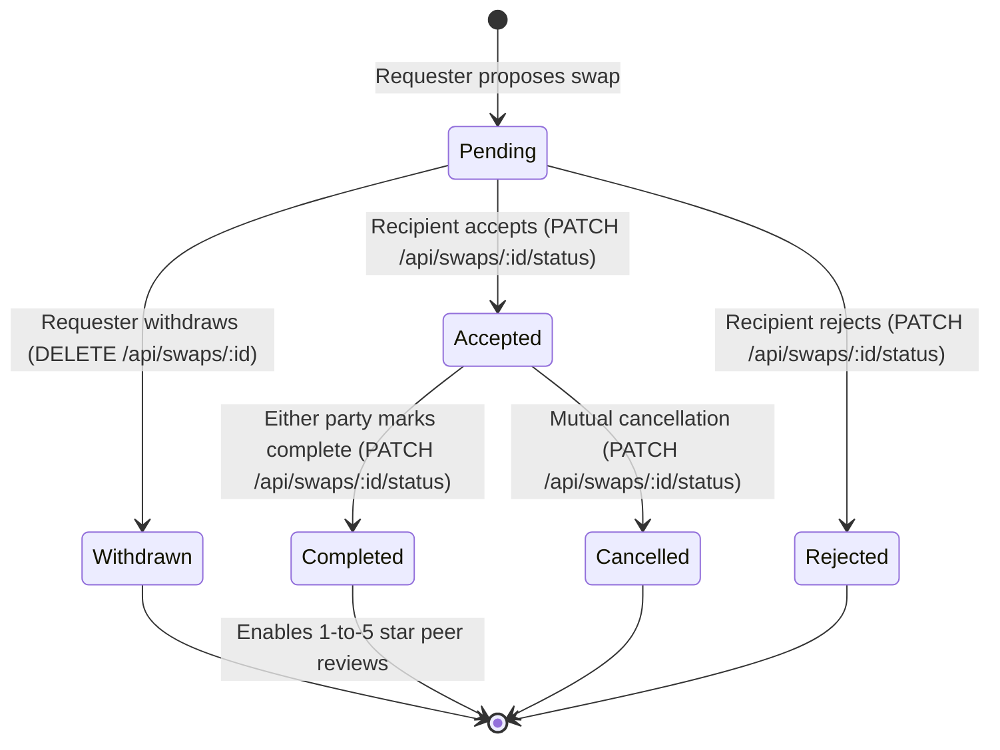

# SkillSwap - Peer-to-Peer Skill Exchange Platform

**SkillSwap** is a full-stack peer-to-peer skill exchange platform designed to enable community members, creators, developers, and artists to trade their knowledge and learn collaboratively without monetary transactions.

The project is structured with a decoupled **Backend (Node.js, Express, MySQL)** and **Frontend (Vanilla HTML5, CSS3, JavaScript)** architecture, inspired by professional modular enterprise designs.

---

## 1. Technology Stack

- **Frontend**: HTML5, Vanilla CSS3 (Custom Design System), Modern Vanilla JavaScript (ES6+)
- **Backend**: Node.js & Express.js
- **Database**: MySQL 8.0+
- **Database Driver**: `mysql2` (Promise-based connection pool)
- **Authentication**: JSON Web Tokens (JWT) & `bcryptjs` password hashing
- **File Uploads**: `multer` (Avatar storage in `backend/uploads/avatars`)
- **API Client**: Centralized native `Fetch API` with bearer token interceptor
- **Development Tooling**: `nodemon` live-reloading

---

## 2. Project Directory Structure

```text
SkillSwap/
├── backend/
│   ├── database/
│   │   ├── schema.sql              # MySQL schema (users, skills, swaps, reviews, etc.)
│   │   └── seed.sql                # Initial test dataset with demo users and skills
│   ├── docs/
│   │   └── api.md                  # Complete REST API specifications
│   ├── src/
│   │   ├── config/
│   │   │   ├── database.js         # MySQL connection pool configuration (mysql2/promise)
│   │   │   └── env.js              # Centralized environment variable loader
│   │   ├── controllers/
│   │   │   ├── authController.js   # Register, Login, Me endpoints
│   │   │   ├── userController.js   # Profiles, discovery, avatar upload
│   │   │   ├── skillController.js  # Catalog & user skill associations
│   │   │   ├── swapController.js   # Swap request lifecycle (propose, accept, complete)
│   │   │   ├── reviewController.js # Peer reviews and rating aggregation
│   │   │   ├── notificationController.js # In-app notification center
│   │   │   └── adminController.js  # Moderation, metrics, and audit logs
│   │   ├── middleware/
│   │   │   ├── auth.js             # JWT bearer verification middleware
│   │   │   ├── adminAuth.js        # Admin role authorization guard
│   │   │   ├── upload.js           # Multer diskStorage for avatar uploads
│   │   │   ├── validate.js         # Request payload validator
│   │   │   └── errorHandler.js     # Centralized Express error handler
│   │   ├── routes/
│   │   │   ├── authRoutes.js       # /api/auth
│   │   │   ├── userRoutes.js       # /api/users
│   │   │   ├── skillRoutes.js      # /api/skills
│   │   │   ├── swapRoutes.js       # /api/swaps
│   │   │   ├── reviewRoutes.js     # /api/reviews
│   │   │   ├── notificationRoutes.js # /api/notifications
│   │   │   └── adminRoutes.js      # /api/admin
│   │   ├── services/
│   │   │   ├── authService.js      # Authentication and password hashing logic
│   │   │   ├── userService.js      # User queries and avatar updates
│   │   │   ├── skillService.js     # Catalog query logic
│   │   │   ├── swapService.js      # Swap validation and counterparty notifications
│   │   │   ├── reviewService.js    # Review submission verification
│   │   │   └── notificationService.js # Notification insertion and read toggling
│   │   ├── utils/
│   │   │   ├── ApiError.js         # Operational error class with HTTP status codes
│   │   │   ├── asyncHandler.js     # Express async wrapper
│   │   │   └── validators.js       # Form validation helper functions
│   │   └── app.js                  # Express application setup & middleware stack
│   ├── uploads/
│   │   └── avatars/
│   │       └── .gitkeep            # Preserved avatar directory
│   ├── .env                        # Local development environment configuration
│   ├── .env.example                # Environment variable template
│   ├── .gitignore                  # Backend ignore rules
│   ├── nodemon.json                # Nodemon watcher configuration
│   ├── package.json                # Backend dependencies and scripts
│   ├── seed.js                     # Safe database seeding script
│   └── server.js                   # Application server entry point
│
├── frontend/
│   ├── assets/
│   │   ├── img/                    # Static image assets
│   │   └── icons/                  # Static icon assets
│   ├── css/
│   │   ├── style.css               # Core CSS variables, typography, and buttons
│   │   ├── auth.css                # Login and register form styles
│   │   ├── dashboard.css           # Stat cards and metrics grids
│   │   ├── profile.css             # Profile banner and skill tag styling
│   │   ├── discover.css            # Search bar and member card grid
│   │   └── responsive.css          # Tablet and mobile media queries
│   ├── js/
│   │   ├── config.js               # Global configuration (API endpoints)
│   │   ├── api.js                  # Centralized Fetch API client with auth headers
│   │   ├── auth.js                 # Session management and route guards
│   │   ├── ui.js                   # Toast alerts, navbar state, and formatting
│   │   ├── home.js                 # Featured skills loader
│   │   ├── discover.js             # Marketplace search & filter logic
│   │   ├── profile.js              # Profile details & skills showcase
│   │   ├── skills.js               # Skills catalog client
│   │   ├── swaps.js                # Exchange proposal & status action handlers
│   │   ├── reviews.js              # Review and rating helpers
│   │   ├── notifications.js        # Notification listing & read state
│   │   └── admin.js                # Admin console statistics & user moderation
│   ├── index.html                  # Landing page
│   ├── login.html                  # Sign in page
│   ├── register.html               # Sign up page
│   ├── discover.html               # Skill & member discovery catalog
│   ├── profile.html                # User profile & skills breakdown
│   ├── dashboard.html              # Member dashboard & metrics
│   ├── my-swaps.html               # Swap exchange management
│   ├── notifications.html          # Alerts & notification center
│   └── admin.html                  # Administrator moderation panel
│
├── .gitignore                      # Git ignore rules for root
├── package.json                    # Root orchestration package
└── README.md                       # Project documentation
```

---

## 3. Prerequisites

Before running the application, make sure you have installed:
1. **Node.js** (v18.x or later recommended) & `npm`
2. **MySQL Server** (v8.0+ or compatible MariaDB server)

---

## 4. Setup & Installation

### Step 1: Install Backend Dependencies
From the project root:
```bash
npm run install:backend
```
*Or navigate to the backend folder directly:*
```bash
cd backend
npm install
```

### Step 2: Configure Environment Variables
A `.env` file has been pre-created in `backend/.env`. Verify that your MySQL credentials match your local MySQL configuration:

```env
PORT=5000
NODE_ENV=development

# MySQL Database Configuration
DB_HOST=127.0.0.1
DB_PORT=3306
DB_USER=root
DB_PASSWORD=your_mysql_password_here
DB_NAME=skillswap_db

# JWT Configuration
JWT_SECRET=dev_jwt_secret_skillswap_super_safe_key_2026
JWT_EXPIRES_IN=7d
```

### Step 3: Initialize Database & Seed Data
Start your local MySQL service, then run the safe automated database seeder:
```bash
npm run seed
```
*Or from inside `backend`:*
```bash
node seed.js
```

The seeder automatically:
- Creates the `skillswap_db` database if it doesn't already exist.
- Executes `backend/database/schema.sql` to build the tables, foreign keys, and indexes.
- Populates `backend/database/seed.sql` with demo skills, user accounts, swaps, and reviews.

#### Default Test Accounts (Generated by `seed.sql`):
| Role | Email | Password |
|---|---|---|
| **Admin** | `admin@skillswap.com` | `Password123!` |
| **User (Sarah Chen)** | `sarah.chen@example.com` | `Password123!` |
| **User (Marcus Sterling)** | `marcus.sterling@example.com` | `Password123!` |

---

## 5. Running the Application

### Start the Backend Server
```bash
npm run dev
```
*Or inside `backend`:*
```bash
npm run dev
```
The Express API will be running at `http://localhost:5000`. You can test the health check endpoint at `http://localhost:5000/api/health`.

### Open the Frontend
Since the frontend is built entirely using standard HTML5, CSS3, and Vanilla JavaScript, you can open `frontend/index.html` in any modern web browser or serve it with:
- **VS Code Live Server extension** (Right-click `frontend/index.html` -> "Open with Live Server")
- Or with any local static HTTP server:
  ```bash
  npx -y serve frontend
  ```

---

## 6. Core Features & Business Logic

### A. Swap Request Lifecycle & State Machine
Every swap request strictly adheres to transactional integrity rules:



**Swap Validation Rules:**
- **No Self-Swaps**: Requesters cannot propose an exchange to themselves.
- **Skill Ownership Verification**: The offered skill must be in the requester's `offered` skills list; the requested skill must be in the recipient's `offered` skills list.
- **Active Duplicate Prevention**: Multiple pending or active swaps for the same skill pairing between the same users are blocked.
- **Authorized Transitions**:
  - Only the **recipient** can accept or reject a pending swap.
  - Only the **requester** can withdraw a pending swap.
  - Only **participants** can mark an accepted swap as completed.
  - Accepted and completed swaps cannot be deleted as pending requests.

### B. Private Profile Visibility Rules
- Users can toggle profile visibility (`is_public: true/false`).
- **Private Profiles (`is_public = 0`)**:
  - Automatically filtered out of public search and discovery (`/api/users`).
  - Access to `/api/users/:id` for private profiles is strictly guarded: visitors receive `403 Forbidden` unless authenticated as the profile owner or a platform administrator.

### C. Peer Reviews & Ratings
- Only participants of an exchange with status `completed` can submit a review.
- Reviews enforce a 1 to 5 star rating scale with an optional written testimonial.
- Self-reviews are strictly prevented.
- Duplicate reviews for the same swap and reviewer are prevented.
- Profile average ratings and review totals are recalculated live from database records.

### D. Admin Console & Platform Moderation
The `/admin.html` dashboard provides comprehensive administrative tooling:
- **Live Statistics**: Total registered users, public profiles, active/pending/completed swaps, and review metrics.
- **User Moderation**: Suspend or reactivate user accounts with real-time audit logging.
- **Catalog Moderation**: Remove inappropriate or duplicate skills from the catalog.
- **Swap Monitoring**: Live overview of all active, pending, completed, and rejected platform swaps.
- **Announcements**: Publish platform-wide banner notices for all members.
- **CSV Data Exports**: Real-time streaming CSV exports for:
  - Users: `GET /api/admin/export/users`
  - Swaps: `GET /api/admin/export/swaps`
  - Feedback/Reviews: `GET /api/admin/export/feedback`
- **Audit Logs**: Comprehensive activity log tracking admin status toggles, announcements, and deletions.

---

## 7. Security Architecture

1. **Password Security**: Passwords hashed with `bcryptjs` using 10 salt rounds. Plain-text passwords are never stored.
2. **JWT Authentication**: Stateless authentication using signed JSON Web Tokens sent via standard `Authorization: Bearer <token>` headers.
3. **Role-Based Access Control**: Strict backend verification of user vs. admin roles. Frontend role values are never trusted.
4. **Rate Limiting**: `express-rate-limit` protects authentication endpoints (`/api/auth/login` and `/api/auth/register`) against brute-force attacks.
5. **Secure HTTP Headers**: `helmet` configured on all Express HTTP responses.
6. **File Upload Hardening**: `multer` restricts avatar uploads to JPEG, PNG, and WEBP under 2MB, storing them with unique sanitized timestamps.
7. **SQL Injection Defense**: 100% of SQL database operations use parameterized statements via `mysql2/promise`.
8. **Atomic Transactions**: Multi-step operations (e.g., status changes that generate notifications) use `withTransaction` connection isolation.

---

## 8. Automated Testing

SkillSwap includes an automated integration test script that validates the full stack without third-party testing bloat.

To run the integration tests:
1. Ensure your backend server is running (`npm run dev`).
2. Run the test suite:
   ```bash
   node backend/tests/integration.test.js
   ```

**Covered Test Assertions:**
- Health check API (`GET /api/health`)
- User authentication & JWT issuance (`POST /api/auth/login`)
- Admin authentication & privileges (`POST /api/auth/login`)
- Authenticated user profile retrieval (`GET /api/auth/me`)
- User marketplace search & discovery (`GET /api/users`)
- Skills catalog retrieval (`GET /api/skills`)
- Admin platform statistics calculation (`GET /api/admin/stats`)
- Admin swap monitoring (`GET /api/admin/swaps`)
- CSV stream generation (`GET /api/admin/export/users`)
- In-app notification center retrieval (`GET /api/notifications`)

---

## 9. API Documentation

Detailed REST API endpoints, request bodies, query parameters, and responses are documented in [api.md](file:///Users/pareshtank/Desktop/SkillSwap/SkillSwap/backend/docs/api.md).

